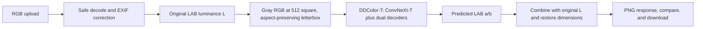

# ColorGen AI

ColorGen AI is a Flask application with a responsive HTML, CSS, and vanilla JavaScript interface. **DDColor-T is the sole supported colorization model.** It uses the official DDColor authors' pretrained tiny checkpoint; the application does not train a model or switch to another engine.

Colorization is an interpretation: grayscale brightness does not reveal exact original colors. Predicted colors may be plausible but historically or factually wrong. Scratch removal and face restoration are not implemented.

## Screenshots and sample output

- *Screenshot placeholder — add a capture of the running website here.*
- Generated comparison images and test outputs are kept locally and excluded from Git.

## Architecture



## Technology

- Frontend: semantic HTML5, CSS3, vanilla JavaScript, Fetch API
- Backend: Python, Flask, Pillow, OpenCV, NumPy, PyTorch
- Model: DDColor-T / ConvNeXt-T with dual decoders
- Tests: pytest; scikit-image supplies a real cat photo for the optional checkpoint integration test

## Model and weights

The application loads the official DDColor tiny checkpoint, pinned by repository revision and SHA-256. Checkpoint tensor keys are loaded strictly. A missing, corrupt, or incompatible checkpoint is reported by the health endpoint and colorization requests return a structured error; the application never substitutes random or alternative weights.

- Architecture source: [official DDColor repository](https://github.com/piddnad/DDColor), Apache-2.0.
- Selected weights: [piddnad/ddcolor_paper_tiny](https://huggingface.co/piddnad/ddcolor_paper_tiny), Apache-2.0.
- Pinned revision: `fa6a961`.
- SHA-256: `8a1277bc90a1bfbb6d2d83933a9a6bc821931879ca93e26e4fcec12165d41fce`.
- Official configuration: ConvNeXt-T, `MultiScaleColorDecoder`, 512×512 input, 100 color queries, 3 scales, 9 decoder layers.
- Vendored architecture files and the upstream Apache license are in `backend/vendor/`.

The binary checkpoint is not tracked by Git. If it is missing, download the pinned official file and verify it in PowerShell:

```powershell
New-Item -ItemType Directory -Force models | Out-Null
Invoke-WebRequest -Uri "https://huggingface.co/piddnad/ddcolor_paper_tiny/resolve/fa6a961/pytorch_model.bin?download=true" -OutFile models/ddcolor_paper_tiny.bin
$actual = (Get-FileHash models/ddcolor_paper_tiny.bin -Algorithm SHA256).Hash.ToLower()
if ($actual -ne "8a1277bc90a1bfbb6d2d83933a9a6bc821931879ca93e26e4fcec12165d41fce") { throw "DDColor checksum mismatch: $actual" }
```

## Run locally (Windows PowerShell)

Python 3.11 or newer is supported. The checked workspace uses Python 3.14.3 and CPU-only PyTorch.

```powershell
py -3.14 -m venv .venv
.\.venv\Scripts\Activate.ps1
python -m pip install --upgrade pip
python -m pip install --index-url https://download.pytorch.org/whl/cpu "torch>=2.2"
pip install -r requirements.txt
Copy-Item .env.example .env
python -m backend.app
```

Place the verified checkpoint at `models/ddcolor_paper_tiny.bin`, then open [http://127.0.0.1:5000](http://127.0.0.1:5000). The model loads once at application startup. CPU inference is supported; CUDA is used automatically when available, or can be selected with `COLORGEN_DEVICE=cpu` or `COLORGEN_DEVICE=cuda`.

The default upload limit is 12 MiB and decoded images are limited to 20 megapixels. EXIF orientation is applied and transparent pixels are composited onto white. Animated GIF and WebP uploads use their first frame. The result retains the original dimensions and aspect ratio. Uploads are not retained.

### Accepted image formats

The upload picker is populated from the decoders registered in the running Pillow installation. JPEG/JPG, PNG, WebP, BMP, TIFF/TIF, and GIF are supported by the standard Pillow install. AVIF is listed when Pillow was built with AVIF decoding (Pillow 11.3 in the verified workspace has this enabled). HEIC/HEIF is optional; install and register Pillow-Heif to enable it:

```powershell
.\.venv\Scripts\python.exe -m pip install pillow-heif
```

The application detects the optional decoder on startup and advertises HEIC/HEIF only when Pillow registers it. The file extension and browser-provided MIME type are not trusted for decoding; the backend checks the actual file contents. Browsers that cannot preview TIFF, HEIC, or other formats show a preview-unavailable message, but the user can still submit the image for server-side decoding. Transparent images are composited on white. Only the first frame of animated GIF and WebP files is colorized.

## Configuration

Settings are optional and may be placed in `.env`:

- `COLORGEN_DDCOLOR_CHECKPOINT`: checkpoint path; defaults to `models/ddcolor_paper_tiny.bin`.
- `COLORGEN_DDCOLOR_INPUT_SIZE`: square inference input size; defaults to `512`.
- `COLORGEN_MAX_UPLOAD_BYTES`: upload limit in bytes; defaults to `12582912`.
- `COLORGEN_MAX_IMAGE_PIXELS`: decoded image limit; defaults to `20000000` pixels.
- `COLORGEN_DEVICE`: `auto`, `cpu`, or `cuda`; defaults to `auto`.
- `PORT`: Flask port; defaults to `5000`.

There is no model-engine selection setting: DDColor-T is the only supported engine.

## API

### `GET /api/health`

Returns server status, checkpoint availability, active model (`ddcolor`), device, upload and pixel limits, the actual decoder-supported upload formats, and DDColor configuration.

### `GET /api/model-info`

Returns DDColor-T architecture and input/output descriptions, checkpoint status, model ID, and available evaluation metadata. The official checkpoint does not bundle validation metrics, so those fields are null.

### `POST /api/colorize`

Send multipart form data with an `image` field. Success returns PNG bytes and the `X-Inference-Time-Ms`, `X-Image-Width`, and `X-Image-Height` headers.

```powershell
curl.exe -X POST -F "image=@photo.jpg" http://127.0.0.1:5000/api/colorize --output colorized.png
```

Errors return structured JSON, for example `{"error":{"code":"checkpoint_unavailable","message":"..."}}`. The formats available on this running installation are listed by `GET /api/health`; unsupported, corrupt, oversized, and undecodable images receive structured errors. Image outputs are returned as RGB PNGs.

## Tests

```powershell
python -m compileall backend tests
python -m pytest -q
```

Install `requirements-test.txt` for the optional real-checkpoint test fixture:

```powershell
pip install -r requirements-test.txt
```

The suite covers DDColor loading and preprocessing, missing and invalid weights, JPEG/PNG/WebP/BMP/TIFF/GIF uploads, transparency, first-frame behavior, mislabeled file uploads, unsupported/corrupt/oversized files, API response format and dimensions, and required frontend controls. AVIF and HEIF tests run when the corresponding Pillow decoder is installed. When the official checkpoint and scikit-image are present, an integration test sends a grayscale cat photo through Flask using the real DDColor-T model.

Verified in this workspace: **21 tests passed in 11.34 seconds** with the installed checkpoint.

## Deployment

Deployment has not been performed. The Dockerfile and Gunicorn configuration are included. Keep the checkpoint outside source control and mount it at the configured checkpoint path. CPU inference is supported; free hosting tiers may not provide a GPU or enough disk space for the roughly 220 MB checkpoint.

## Limitations and attribution

- Exact original colors cannot be recovered from grayscale; DDColor predicts plausible colors.
- The current integration has been sanity-checked on a cat photograph, not benchmarked across a broad held-out set of image categories.
- PSNR and SSIM measure image similarity, not whether a person finds the colors convincing.
- Scratch removal, face restoration, and manual color controls are not implemented.
- DDColor source and weights are published under Apache-2.0. Review the upstream repository and model page for notices and attribution.
